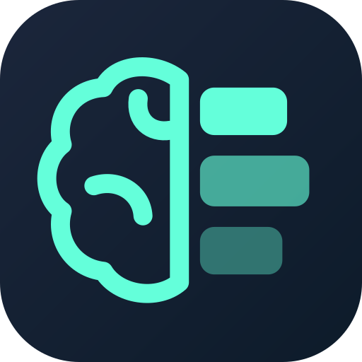
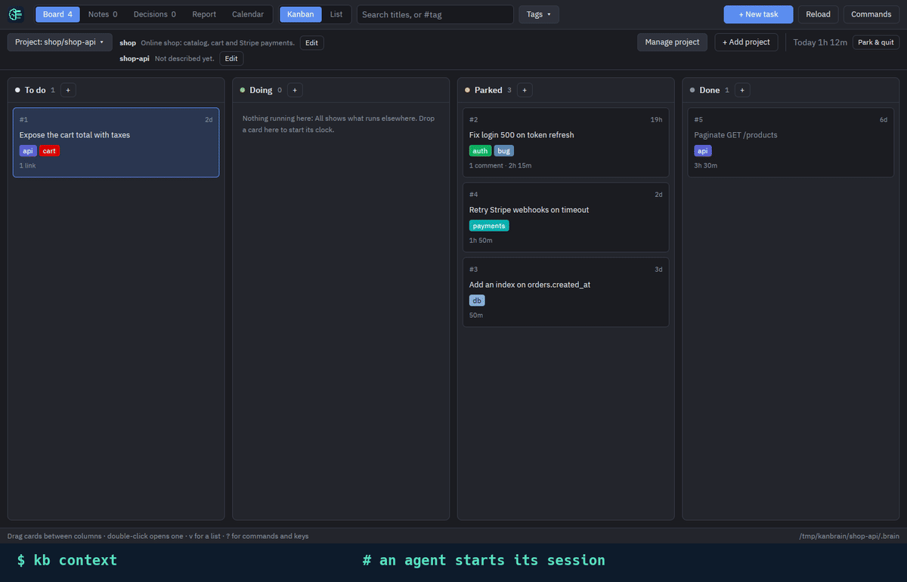

<div align="center">




<br/>


<br/>

[](https://github.com/singudotdev/kanbrain/actions/workflows/ci.yml)
[](https://github.com/singudotdev/kanbrain/releases/latest)
[](LICENSE)


</div>

<p align="center"></p>

**Project memory for you and your coding agents.** Tasks, decisions and notes stored as plain markdown files next to
your code, with a kanban board for you and a CLI for agents. Agents keep the board current and stop to ask you when a
choice is yours; you answer on the board. Time is tracked automatically.

- **`kb`**: the command line. Agents and scripts use it. It's a single small binary and works over SSH.
- **`kanbrain`**: the kanban board (To do · Doing · Parked · Done). Changes an agent makes with `kb` show up on
  the board within a second. Given arguments, it takes `kb`'s commands too.

Both programs read and write the same files. There's no database: you can read the files, grep them and commit them
with git.

## 1. Install

**Linux / macOS**, the command line (`kb`):

```sh
curl -fsSL https://github.com/singudotdev/kanbrain/releases/latest/download/install.sh | sh
```

The command line and the kanban board (`kb` and `kanbrain`):

```sh
curl -fsSL https://github.com/singudotdev/kanbrain/releases/latest/download/install.sh | sh -s -- --app both
```

**Windows (PowerShell)**, the command line (`kb`):

```powershell
irm https://github.com/singudotdev/kanbrain/releases/latest/download/install.ps1 | iex
```

The command line and the kanban board (`kb` and `kanbrain`):

```powershell
$env:KANBRAIN_APP = "both"; irm https://github.com/singudotdev/kanbrain/releases/latest/download/install.ps1 | iex
```

With Rust, the command line also installs from crates.io: `cargo install kanbrain`.

The installers only install for your own user, inside your home folder, so don't run them with `sudo` or as
administrator. For other options, updating, uninstalling or building from source, see
[Getting started](docs/getting-started.md).

## 2. Connect a project to its agents

```sh
cd my-project
kb init
```

Or, in the kanban app, click **+ Add project** and pick the project's folder.

Either way, this sets up everything an agent needs:

1. **Creates `.brain/`**, the project's data folder. Any command run in the project, or in a folder below it, uses it,
   the same way git finds `.git`. Commit it to share the memory, or add it to `.gitignore` to keep it local.
2. **Registers the project** in the central brain, so the board can show it next to your other projects. It also
   creates a project card for the application's shared context, which every agent session starts by reading. The
   agent writes it; how to build and test each repository stays in its `CLAUDE.md`.
3. **Tells the agents how to use it.** It writes a short "Project memory" section into `CLAUDE.md` and/or `AGENTS.md`
   (it creates `CLAUDE.md` if neither file exists). Agents read that file at the start of every session. The section
   sits between `<!-- kanbrain:start/end -->` markers, so the rest of the file is left alone. For Claude Code it
   also adds hooks to `.claude/settings.local.json`: they hand the agent `kb context` at the start of each session
   and after compaction, remind it to describe an undescribed project and to comment on the task it started, tell
   it of your comments on a task it's working on with its next step, and send it to `kb` when it tries to write the
   brain's files itself. Upgrading refreshes them in every project: the installer and `kb update` run
   `kb init --all`, and `kb context` adds a release's new hooks with the next session.

To stop a repository being a project, run `kb deinit` in it, or `kb --project NAME deinit` from
anywhere. This unregisters it and removes the section, but keeps `.brain/` and its data.

### How an agent uses it

Once the project is set up, a typical agent session looks like this, with no extra prompting from you:

```sh
kb context                         # 1. start of session: project card, active tasks with their latest
                                   #    comment, recently done, decisions, notes
kb project describe -              #    once, if context says the project isn't described yet
kb search login                    # 2. find the task (or `add "Fix login 500"`)
kb start 4                         # 3. clock starts (an agent can run several at once)
kb comment 4 "token refresh race; fix next"   # 4. a step done, a cause found: one or two lines
echo "Context…/Decision…/Consequences…" | \
  kb add --decision --link 4 --body - "Retry refresh once"   # 5. record why an approach was chosen
kb done 4                          # 6. finish
```

When the agent needs you, it doesn't guess: `kb ask 7 "Which region?"` parks the task with the question, and
`kb propose 7 --body - "Store sessions in Redis"` proposes a decision it shouldn't take alone. The board shows those
tasks as **Waiting for you**; you answer with a comment, or accept or reject the decision. An agent waiting with
`kb wait` in the background (Claude Code can) picks your answer up at once; otherwise its next `context` lists those
tasks first, under Answered.

The next session's `context` picks up where this one stopped: the task's latest comment, the decision and the notes.
The section tells the agent the board is watched live, so it moves tasks and comments as it works, not at the end.
Asking it for "todos" or a plan, in any language, creates kanbrain tasks, not entries in its built-in to-do
list; questions don't get one. See [For coding agents](docs/agents.md) for what goes where.

The output is kept small so it doesn't waste the agent's context, and the CLI costs nothing until it's called.
`context` lists titles and ids only, capped at 20 per section. Write commands reply with one line, like
`#4 Fix login 500 (doing) #auth`. `show ID` is how an agent reads one entry in full.

## 3. Commands you'll use most

| command | what it does |
| --- | --- |
| `kb context` | summary for agents: project card, active tasks, recent done, decisions, notes |
| `kb add [--note\|--decision] [--tag T] [--link ID] [--body TEXT\|-] [--start] TITLE` | create a task (or note/decision) |
| `kb start\|park\|done\|todo ID` | move a task; `start` runs its clock (a person runs one task at a time; agents, several) |
| `kb comment ID TEXT` | add a timestamped comment (`-` reads from stdin) |
| `kb ask ID TEXT` | ask the user a question on a task, which waits for the answer in Parked |
| `kb wait ID` | block until a person answers the task's question (or decides on a decision), then print the answer; at most 8 minutes by default |
| `kb propose ID [--body TEXT\|-] TITLE` | propose a decision for a task, for the user to accept or reject |
| `kb accept ID [TEXT]` / `kb reject ID TEXT` | accept or reject a decision, which answers the tasks waiting on it |
| `kb describe ID TEXT` | replace the description |
| `kb rename ID TITLE` | replace the title |
| `kb tag ID +TAG\|-TAG…` | add tags to an entry, or remove them |
| `kb tag OLD NEW` | rename a tag in every entry that has it |
| `kb link ID OTHER…` | link entries to each other (`REPO#ID`: in another repository of the project) |
| `kb project [describe\|notes TEXT\|-]` | show or rewrite the project's description and this repository's role |
| `kb project rename\|repo\|move\|remove` | rename the project or this repository, move it to another project, or remove the project |
| `kb show ID` | one entry in full: status, time, description, comments, links, history |
| `kb search WORDS…` | find entries by words; `#tag` matches tags only |
| `kb list [doing\|todo\|parked\|done\|all] [notes] [decisions] [--tag T] [--json]` | print tasks as markdown |
| `kb status` | the running tasks and their clocks, for status bars |
| `kb report [hour\|day\|week\|month] [--group task\|tag] [--tag T] [--save]` | tracked time as markdown |
| `kb update` | install the latest release over this one |
| `kb completions bash\|zsh\|fish\|powershell` | tab completion of commands, ids, projects and tags |
| `kanbrain` | open the kanban board (`?` opens the command palette, with every key; `u` undoes) |

The entry commands and `list` accept `--json` (all but `wait`, `context` and `project`).
`--project NAME`, given anywhere on the line, runs the command on another registered project from any folder
(`central` for the central brain). Full reference: [Command line](docs/cli.md).

## Key ideas

- **Tasks** move across To do → Doing → Parked → Done. Every move is recorded with its date.
- **One task of yours in Doing at a time**, per brain: starting another while one runs is refused, so nothing gets
  set aside behind your back. Agents aren't limited: one splitting its work between subagents runs a task per
  subagent. Running tasks show in cyan when you started them, in green when an agent did. On the board, **Park &
  quit** (`Q`) ends the day.
- **Notes** record what you learned. **Decisions** record what was chosen and why, using the ADR sections Context,
  Decision and Consequences. Both link to tasks by id. A decision an agent proposes waits for you to accept or
  reject it.
- **Agents ask, you answer.** A task an agent asked about waits in Parked as **Waiting for you** until you comment.
  Every comment and move records whether a person or an agent made it.
- **Central brain vs project brains.** Anything outside a project goes to the central folder
  (`~/.local/share/kanbrain` on Linux, or `$KANBRAIN_DIR`). Each project has its own `.brain/`. The board
  shows all of them together.
- **Multi-repo projects.** Run `kb init shop` in each repository. Each one keeps its own tasks and its role
  in the app, and they all share the `shop` project card. An agent that needs work in another service leaves it a
  task there, linked to its own with `kb link ID REPO#ID`.

## Documentation

| | |
| --- | --- |
| [Getting started](docs/getting-started.md) | install options, first run, where data lives |
| [For coding agents](docs/agents.md) | `init`, the agent workflow, keeping it cheap, JSON output |
| [Command line](docs/cli.md) | every command and option, `init` and `deinit` |
| [Tasks, tags & search](docs/tasks-and-tags.md) | statuses, history, tags, comments, notes and decisions |
| [Time tracking](docs/time-tracking.md) | sessions and reports |
| [Keybindings](docs/keybindings.md) | every key and mouse action on the board |
| [Data format](docs/data-format.md) | the markdown files, and editing them by hand |
| [Integrations](docs/integrations.md) | status bars, syncing with git or cloud folders, notes apps |
| [FAQ & troubleshooting](docs/faq.md) | common questions and fixes |
| [Development](docs/development.md) | architecture, building, testing, contributing |

## License

[AGPL-3.0-only](LICENSE), with the additional terms in [NOTICE](NOTICE): you may use, change and share kanbrain.
Anything built on it that you distribute, or that others use over a network (as a hosted service, say), must be
shared under the same license, with its source. It must also keep the attribution "Based on kanbrain by
singudotdev", say it's a modified version, never present kanbrain as its own work, and use another name and logo: the
license grants no rights to kanbrain's name or logo. The release archives also carry `THIRD-PARTY-LICENSES.txt`, the
licenses of the libraries and fonts compiled into each program.

<div align="center">

</div>
